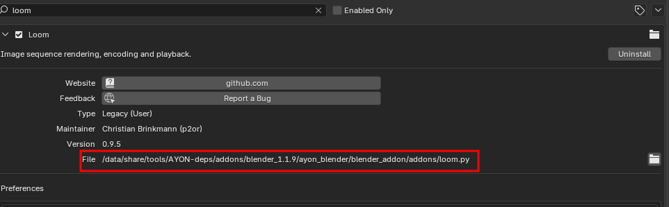

---

```shell
curl --location https://download.blender.org/release/Blender5.2/blender-5.2.1-linux-x64.tar.xz \
    --output ~/Downloads/blender-5.2.1-linux-x64.tar.xz
tar -xvf ~/Downloads/blender-5.2.1-linux-x64.tar.xz -C $(dirname ~/Downloads/blender-5.2.1-linux-x64.tar.xz)
```

- https://transloadit.com/devtips/decompress-archives-directly-with-curl-and-command-line/

```shell
# https://download.blender.org/release
# https://www.blender.org/download/lts/
version="4.5.13"
pname="blender"
# https://stackoverflow.com/a/50400861
BLENDER="${version%.*}"

curl --location https://download.blender.org/release/Blender${BLENDER}/${pname}-${version}-linux-x64.tar.xz \
    --output ./${pname}-${version}-linux-x64.tar.xz
tar -xvf ./${pname}-${version}-linux-x64.tar.xz
```

```shell
# cd ./configs/components/fhs/buildFHSEnv/blender

curl -fsSL https://download.blender.org/release/Blender${BLENDER}/${pname}-${version}-linux-x64.tar.xz \
    | tar \
        --xz \
        --extract \
        --verbose \
        --file -

# rsync:
rsync -rhav --progress ./${pname}-${version}-linux-x64 user@miniboss.meemoo.lan:/data/share/tools/.stage

# rsync from stdin (does not work):
# - https://stackoverflow.com/a/20161267
# - https://hackerpublicradio.org/eps/hpr4373/index.html

# command over ssh
# - https://www.funwithlinux.net/blog/passing-variables-in-remote-ssh-command/
ssh -t user@miniboss.meemoo.lan -- stat /data/share/tools/.stage/${pname}-${version}-linux-x64 \
    && ssh -t user@miniboss.meemoo.lan -- mv /data/share/tools/.stage/${pname}-${version}-linux-x64 /data/share/tools

rm -rf ./${pname}-${version}-linux-x64
```

`export BLENDER_USER_SCRIPTS="/data/share/tools/AYON-deps/addons/blender_1.1.9/ayon_blender/blender_addon/"`:


---

# Test: Manually setting PYTHONPATH

- [x] tested
- [x] working

```python
# in Blender
import sys
print(sys.path)
['/data/share/tools/AYON-deps/addons/zbrush_0.4.1', '/data/share/tools/AYON-deps/addons/unreal_0.4.0', '/data/share/tools/AYON-deps/addons/tvpaint_0.4.3', '/data/share/tools/AYON-deps/addons/traypublisher_0.4.5', '/data/share/tools/AYON-deps/addons/timers_manager_0.2.0', '/data/share/tools/AYON-deps/addons/substancepainter_0.3.6', '/data/share/tools/AYON-deps/addons/substancedesigner_0.2.1', '/data/share/tools/AYON-deps/addons/slack_1.3.1', '/data/share/tools/AYON-deps/addons/sitesync_1.3.2', '/data/share/tools/AYON-deps/addons/silhouette_0.2.2', '/data/share/tools/AYON-deps/addons/premiere_0.2.3', '/data/share/tools/AYON-deps/addons/photoshop_0.4.7', '/data/share/tools/AYON-deps/addons/openrv_1.2.3', '/data/share/tools/AYON-deps/addons/ayon_ocio_1.2.2', '/data/share/tools/AYON-deps/addons/nuke_0.4.15', '/data/share/tools/AYON-deps/addons/motionbuilder_0.2.1', '/data/share/tools/AYON-deps/addons/mocha_1.1.0', '/data/share/tools/AYON-deps/addons/maya_0.6.12', '/data/share/tools/AYON-deps/addons/max_0.5.1', '/data/share/tools/AYON-deps/addons/marvelous_designer_1.1.3', '/data/share/tools/AYON-deps/addons/kitsu_1.2.7', '/data/share/tools/AYON-deps/addons/houdini_0.10.7', '/data/share/tools/AYON-deps/addons/hiero_0.6.3', '/data/share/tools/AYON-deps/addons/harmony_0.5.4', '/data/share/tools/AYON-deps/addons/fusion_0.4.2', '/data/share/tools/AYON-deps/addons/flame_1.4.3', '/data/share/tools/AYON-deps/addons/deadline_0.7.3', '/data/share/tools/AYON-deps/addons/resolve_0.6.3', '/data/share/tools/AYON-deps/addons/clockify_0.2.2', '/data/share/tools/AYON-deps/addons/cinema4d_0.2.0', '/data/share/tools/AYON-deps/addons/celaction_0.2.5', '/data/share/tools/AYON-deps/addons/blender_1.1.9', '/data/share/tools/AYON-deps/addons/applications_1.4.6', '/data/share/tools/AYON-deps/addons/aftereffects_0.3.7', '/data/share/tools/AYON-deps/addons/ayon_third_party_1.4.0', '/data/share/tools/AYON-deps/addons/equalizer_0.2.1', '/data/share/tools/AYON-deps/addons/blender_1.1.9/ayon_blender/blender_addon/startup', '/data/share/tools/blender-4.4.3-linux-x64/4.4/scripts/startup', '/data/share/tools/blender-4.4.3-linux-x64/4.4/scripts/modules', '/data/share/tools/AYON-deps/addons/blender_1.1.9/ayon_blender/blender_addon', '/data/share/tools/AYON-deps/addons/core_1.9.12/ayon_core/vendor/python', '/data/share/tools/AYON-1.6.3-linux-rocky9/common', '/data/share/tools/AYON-1.6.3-linux-rocky9/dependencies', '/data/share/tools/AYON-deps/addons/aftereffects_0.3.7', '/data/share/tools/AYON-deps/addons/applications_1.4.6', '/data/share/tools/AYON-deps/addons/ayon_ocio_1.2.2', '/data/share/tools/AYON-deps/addons/ayon_third_party_1.4.0', '/data/share/tools/AYON-deps/addons/blender_1.1.9', '/data/share/tools/AYON-deps/addons/celaction_0.2.5', '/data/share/tools/AYON-deps/addons/cinema4d_0.2.0', '/data/share/tools/AYON-deps/addons/clockify_0.2.2', '/data/share/tools/AYON-deps/addons/core_1.9.12', '/data/share/tools/AYON-deps/addons/deadline_0.7.3', '/data/share/tools/AYON-deps/addons/equalizer_0.2.1', '/data/share/tools/AYON-deps/addons/flame_1.4.3', '/data/share/tools/AYON-deps/addons/fusion_0.4.2', '/data/share/tools/AYON-deps/addons/harmony_0.5.4', '/data/share/tools/AYON-deps/addons/hiero_0.6.3', '/data/share/tools/AYON-deps/addons/houdini_0.10.7', '/data/share/tools/AYON-deps/addons/kitsu_1.2.7', '/data/share/tools/AYON-deps/addons/marvelous_designer_1.1.3', '/data/share/tools/AYON-deps/addons/max_0.5.1', '/data/share/tools/AYON-deps/addons/maya_0.6.12', '/data/share/tools/AYON-deps/addons/mocha_1.1.0', '/data/share/tools/AYON-deps/addons/motionbuilder_0.2.1', '/data/share/tools/AYON-deps/addons/nuke_0.4.15', '/data/share/tools/AYON-deps/addons/openrv_1.2.3', '/data/share/tools/AYON-deps/addons/photoshop_0.4.7', '/data/share/tools/AYON-deps/addons/premiere_0.2.3', '/data/share/tools/AYON-deps/addons/resolve_0.6.3', '/data/share/tools/AYON-deps/addons/silhouette_0.2.2', '/data/share/tools/AYON-deps/addons/sitesync_1.3.2', '/data/share/tools/AYON-deps/addons/slack_1.3.1', '/data/share/tools/AYON-deps/addons/substancedesigner_0.2.1', '/data/share/tools/AYON-deps/addons/substancepainter_0.3.6', '/data/share/tools/AYON-deps/addons/timers_manager_0.2.0', '/data/share/tools/AYON-deps/addons/traypublisher_0.4.5', '/data/share/tools/AYON-deps/addons/tvpaint_0.4.3', '/data/share/tools/AYON-deps/addons/unreal_0.4.0', '/data/share/tools/AYON-deps/addons/zbrush_0.4.1', '/data/share/tools/AYON-deps/dependency_packages/ayon_2609041250_linux-rocky9.zip/dependencies', '/data/share/tools/blender-4.4.3-linux-x64/4.4/python/lib/python311.zip', '/data/share/tools/blender-4.4.3-linux-x64/4.4/python/lib/python3.11', '/data/share/tools/blender-4.4.3-linux-x64/4.4/python/lib/python3.11/lib-dynload', '/home/michael/.local/lib/python3.11/site-packages', '/data/share/tools/blender-4.4.3-linux-x64/4.4/python/lib/python3.11/site-packages', '/data/share/tools/blender-4.4.3-linux-x64/4.4/scripts/freestyle/modules', '/data/share/tools/AYON-deps/addons/blender_1.1.9/ayon_blender/blender_addon/addons/modules', '/data/share/tools/blender-4.4.3-linux-x64/4.4/scripts/addons_core', '/data/share/tools/AYON-deps/addons/blender_1.1.9/ayon_blender/blender_addon/addons', '/home/michael/.config/blender/4.4/scripts/addons']
import ayon_core
ayon_core
# <module 'ayon_core' from '/data/share/tools/AYON-deps/addons/core_1.9.12/ayon_core/__init__.py'>
```

```python
# In Blender
import os
os.environ
# environ({'SHELL': '/run/current-system/sw/bin/bash', 'SESSION_MANAGER': 'local/lenovo:@/tmp/.ICE-unix/2663,unix/lenovo:/tmp/.ICE-unix/2663', 'XDG_VIRTUAL_MACHINES_ROOT_DIR': '/home/michael/Virtual Machines', 'WINDOWID': '94765832134496', 'KITSU_PWD': 'mysecretpassword', 'AYON_BLENDER_USE_SYSTEM_PATH': '1', '__ETC_PROFILE_DONE': '1', 'KITSU_LOGIN': 'admin@example.com', '__HM_SESS_VARS_SOURCED': '1', 'COLORTERM': 'truecolor', 'XDG_CONFIG_DIRS': '/nix/store/ff4srbj887v7sill6f1h2rwjdqigwl6d-plasma-workspace-6.6.6/etc/xdg:/nix/store/y1vk5dxfh3rgbjpsxy9xxgijwhh3sszp-kglobalacceld-6.6.6/etc/xdg:/nix/store/smzr5kspawfys7a05gy1xzvjr0g6zif9-baloo-6.26.0/etc/xdg:/home/michael/.config/kdedefaults:/home/michael/.config/kdedefaults:/etc/xdg:/home/michael/.nix-profile/etc/xdg:/nix/profile/etc/xdg:/home/michael/.local/state/nix/profile/etc/xdg:/etc/profiles/per-user/michael/etc/xdg:/nix/var/nix/profiles/default/etc/xdg:/run/current-system/sw/etc/xdg', 'XDG_SESSION_PATH': '/org/freedesktop/DisplayManager/Session1', 'AYON_APP_TOOLS': '', 'XDG_MENU_PREFIX': 'plasma-', 'JDK_HOME': '/nix/store/8g767zqw78rcf32pyak26nfnhbglzxza-jetbrains-jdk-jcef-25.0.2-b329.72/lib/openjdk', 'AYON_MENU_LABEL': 'AYON', 'XDG_SCREENCASTS_DIR': '/home/michael/Videos/Screencasts', 'PYCHARM_JDK': '/nix/store/8g767zqw78rcf32pyak26nfnhbglzxza-jetbrains-jdk-jcef-25.0.2-b329.72/lib/openjdk', 'TERMINAL_EMULATOR': 'JetBrains-JediTerm', 'PKG_CONFIG_PATH': '/usr/lib/pkgconfig:/usr/lib/pkgconfig', 'ICEAUTHORITY': '/run/user/1001/iceauth_GRFugr', 'AYON_APP_NAME': 'blender/4-4-3-alacritty', 'AYON_ADDONS_DIR': '/data/share/tools/AYON-deps/addons', 'PROCESS_LAUNCHED_BY_Q': '1', 'JAVA_HOME': '/nix/store/8g767zqw78rcf32pyak26nfnhbglzxza-jetbrains-jdk-jcef-25.0.2-b329.72/lib/openjdk', 'XDG_BIN_HOME': '/home/michael/.local/bin', 'SYSTEMD_XKB_DIRECTORY': '/etc/X11/xkb', 'XDG_DATA_HOME': '/home/michael/.local/share', 'AYON_WEBSERVER_URL': 'http://127.0.0.1:48802', 'XDG_CONFIG_HOME': '/home/michael/.config', 'XCURSOR_PATH': '~/.local/share/icons:~/.icons:/nix/store/ff4srbj887v7sill6f1h2rwjdqigwl6d-plasma-workspace-6.6.6/share/icons:/home/michael/.icons:/home/michael/.local/share/icons:/home/michael/.nix-profile/share/icons:/home/michael/.nix-profile/share/pixmaps:/nix/profile/share/icons:/nix/profile/share/pixmaps:/home/michael/.local/state/nix/profile/share/icons:/home/michael/.local/state/nix/profile/share/pixmaps:/etc/profiles/per-user/michael/share/icons:/etc/profiles/per-user/michael/share/pixmaps:/nix/var/nix/profiles/default/share/icons:/nix/var/nix/profiles/default/share/pixmaps:/run/current-system/sw/share/icons:/run/current-system/sw/share/pixmaps:/usr/share/icons:/usr/share/pixmaps:/usr/X11R6/lib/X11/icons', 'TERM_SESSION_ID': 'b4919dd0-1683-4f43-90da-01deced898b8', 'MEMORY_PRESSURE_WRITE': 'c29tZSAyMDAwMDAgMjAwMDAwMAA=', 'LOCALE_ARCHIVE_2_27': '/nix/store/ws0j8fvq4agarwyk4z6kps0szj6pkn1q-glibc-locales-2.42-103/lib/locale/locale-archive', 'AYON_DEBUG': '1', 'DESKTOP_SESSION': 'plasma', 'GDK_PIXBUF_MODULE_FILE': '/nix/store/gmw2pasb5da22invj9qn013dlpbd85jz-gdk-pixbuf-loaders.cache', 'GTK_RC_FILES': '/etc/gtk/gtkrc:/home/michael/.gtkrc:/home/michael/.config/gtkrc', 'AYON_EXECUTABLE': '/data/share/tools/AYON-1.6.3-linux-rocky9/ayon', 'XDG_VIRTUAL_MACHINES_QEMU_DIR': '/home/michael/Virtual Machines/qemu', 'EDITOR': 'hx', 'GST_PLUGIN_SYSTEM_PATH_1_0': '/usr/lib/gstreamer-1.0:/usr/lib32/gstreamer-1.0:/usr/lib/gstreamer-1.0:/usr/lib32/gstreamer-1.0', 'AYON_STUDIO_BUNDLE_NAME': '2026.09.0-2026-10-23-02', 'XDG_SEAT': 'seat0', 'BLENDER_USER_SCRIPTS': '/data/share/tools/AYON-deps/addons/blender_1.1.9/ayon_blender/blender_addon/', 'PWD': '/home/michael/git/repos/nix/pkgs/ayon-launcher', 'XDG_VIDEOS_DIR': '/home/michael/Videos', 'NIX_PROFILES': '/run/current-system/sw /nix/var/nix/profiles/default /etc/profiles/per-user/michael /home/michael/.local/state/nix/profile /nix/profile /home/michael/.nix-profile', 'XDG_SESSION_DESKTOP': 'KDE', 'LOGNAME': 'michael', 'XDG_SESSION_TYPE': 'wayland', 'PROCESS_LAUNCHED_BY_CW': '1', 'NIX_PATH': 'nixpkgs=flake:nixpkgs:/nix/var/nix/profiles/per-user/root/channels', 'SYSTEMD_EXEC_PID': '2882', 'NIXPKGS_CONFIG': '/etc/nix/nixpkgs-config.nix', 'AYON_LAUNCHER_STORAGE_DIR': '/data/share/tools/AYON-deps', 'XAUTHORITY': '/run/user/1001/xauth_HluvHX', 'XDG_PICTURES_DIR': '/home/michael/Pictures', 'XDG_VIRTUAL_MACHINES_VIRTUALBOX_DIR': '/home/michael/Virtual Machines/VirtualBox', 'AYON_STATICS_SERVER': 'http://127.0.0.1:48802/res', 'XKB_DEFAULT_MODEL': 'pc104', 'GTK2_RC_FILES': '/etc/gtk-2.0/gtkrc:/home/michael/.gtkrc-2.0:/home/michael/.config/gtkrc-2.0', 'NIXPKGS_QT6_QML_IMPORT_PATH': '/nix/store/ff4srbj887v7sill6f1h2rwjdqigwl6d-plasma-workspace-6.6.6/lib/qt-6/qml:/nix/store/m94lm3cs7k3g868cvvaiw42kw65fxy21-qtvirtualkeyboard-6.11.3/lib/qt-6/qml:/nix/store/hd245w900rbg3pbx09j6s2jzd6l1fh2g-prison-6.26.0/lib/qt-6/qml:/nix/store/zr2afspwwcmpqaq1kvvr3mamrvs6zych-plasma-nano-6.6.6/lib/qt-6/qml:/nix/store/phxg1bcs1gajqbywqm0d2x0ak46n3yb4-kwin-6.6.6/lib/qt-6/qml:/nix/store/gxrbq2bymqdzd8hcxizfidi1mg5y0dz1-milou-6.6.6/lib/qt-6/qml:/nix/store/zjkq1xjhm3kzgl840gz89yviwsh2lz1n-kpipewire-6.6.6/lib/qt-6/qml:/nix/store/rgff3rrfw9x56knwwxnv1mzz2jv734dg-aurorae-6.6.6/lib/qt-6/qml:/nix/store/2md6b72q62l369jmkgc4wrvl0h53pwll-kuserfeedback-6.26.0/lib/qt-6/qml:/nix/store/9zlaidg6zsq3paxff8d4sviar8i9lrqr-libplasma-6.6.6/lib/qt-6/qml:/nix/store/fn8sxn2c4d6crwixfpwsq0qkb3m67p07-layer-shell-qt-6.6.6/lib/qt-6/qml:/nix/store/g091mn5v8a24yvkc93x7xnr1yn5nb801-ksvg-6.26.0/lib/qt-6/qml:/nix/store/vf9yd9avq1cr47n67gcdwqprjixlnlkz-kirigami-addons-1.12.1/lib/qt-6/qml:/nix/store/38qga58ag85cjwilld09slf4qnn4q8s5-qtmultimedia-6.11.3/lib/qt-6/qml:/nix/store/zqycw7kxz2w75310j5f5h54vbkr815j2-qtquick3d-6.11.3/lib/qt-6/qml:/nix/store/bcfk3bgchlx0pnl40wxyzap7dv9ra8k0-syntax-highlighting-6.26.0/lib/qt-6/qml:/nix/store/1wz6rp12dn8jy9dlrhs8i4jwndhxid2v-kdeclarative-6.26.0/lib/qt-6/qml:/nix/store/smzr5kspawfys7a05gy1xzvjr0g6zif9-baloo-6.26.0/lib/qt-6/qml:/nix/store/0s9f0kgw701aangzhbch1y1j9x5axz7l-qqc2-breeze-style-6.6.6/lib/qt-6/qml:/nix/store/cslv37zbrj8hgr2fqfx8shmjzya9lrhk-plasma5support-6.6.6/lib/qt-6/qml:/nix/store/w5pgb6qxcsi0h9gix4jjcnywfmmlkqwk-plasma-activities-6.6.6/lib/qt-6/qml:/nix/store/fvyr44qpiryxjb1waaxxbpvyfygkwxmd-networkmanager-qt-6.26.0/lib/qt-6/qml:/nix/store/74blbc20gm580c5h52k2jbgfd4mx2g91-libksysguard-6.6.6/lib/qt-6/qml:/nix/store/a6dp0l84gdw26rz9akiawhr5m2ykqls3-kquickcharts-6.26.0/lib/qt-6/qml:/nix/store/glxmb3g6bcgln1bbkzvg13br1c0fjsg7-kitemmodels-6.26.0/lib/qt-6/qml:/nix/store/543i31z4bp987xiz1w3dn87ac8x3j4l3-knewstuff-6.26.0/lib/qt-6/qml:/nix/store/59pvrg8hv13a04adgljj7bawxrasi8jv-kcmutils-6.26.0/lib/qt-6/qml:/nix/store/xz3mg2rc43370as028rng8pahd0mhghi-qqc2-desktop-style-6.26.0/lib/qt-6/qml:/nix/store/pfwzgybg1v2vrmrslvgcyrv42ca7gczs-sonnet-6.26.0/lib/qt-6/qml:/nix/store/rsq2qfx4nnqhpvrwhq8y2vf0vbdcpcj4-kirigami-6.26.0/lib/qt-6/qml:/nix/store/93vh2vbn2v66zdr68bazdwr19jy8a7wb-qt5compat-6.11.3/lib/qt-6/qml:/nix/store/ggcpqkdapg0fiy52ns29dh54169bnzz5-kwindowsystem-6.26.0/lib/qt-6/qml:/nix/store/2j9pwmlg4cvz6r9h4vakag329sj9p3m4-knotifications-6.26.0/lib/qt-6/qml:/nix/store/rxr5zrhizd7dqv46wvffzjyr7bf7j36l-kiconthemes-6.26.0/lib/qt-6/qml:/nix/store/50an3g9pf8pij6d8bvnvs8brrvs6h3rz-ki18n-6.26.0/lib/qt-6/qml:/nix/store/bya43yv607gv6fzin1sp43gp4j6k003h-kholidays-6.26.0/lib/qt-6/qml:/nix/store/2wvgp93k5bjh45dzh816dbg6s2jz3kny-kguiaddons-6.26.0/lib/qt-6/qml:/nix/store/0m32kixngjmcxhf75p4fqy63fx9g7x2x-kcoreaddons-6.26.0/lib/qt-6/qml:/nix/store/zccjqqfj4ax1dq82rsfasgda02nxk3hp-kconfig-6.26.0/lib/qt-6/qml:/nix/store/p68z9ij4x080cz6ilq6rdhq8pmc2z3as-qtwayland-6.11.3/lib/qt-6/qml:/nix/store/hgm52f69ls5xb7k7v73bjqjx88hdxlqd-qtlocation-6.11.3/lib/qt-6/qml:/nix/store/qj0dbv12vqanndr4vh50jz8k4sd4xwa6-qtpositioning-6.11.3/lib/qt-6/qml:/nix/store/j7qrvgg3mprhw8nyi2z1dl5p62g92pja-qtdeclarative-6.11.3/lib/qt-6/qml', 'HOME': '/home/michael', 'XDG_PUBLICSHARE_DIR': '/home/michael/Public', 'SSH_ASKPASS': '/nix/store/55sjhb1cv2hc05g2gifml2qy8akm3rg7-ksshaskpass-6.6.6/bin/ksshaskpass', 'LANG': 'en_US.UTF-8', 'PYSIDE6_OPTION_PYTHON_ENUM': 'True', 'AYON_WEBACTION_EVENT_ID': '55ba92bae5a611f1a77d86aebf0e9dbd', '_JAVA_AWT_WM_NONREPARENTING': '1', 'LS_COLORS': 'rs=0:di=01;34:ln=01;36:mh=00:pi=40;33:so=01;35:do=01;35:bd=40;33;01:cd=40;33;01:or=40;31;01:mi=00:su=37;41:sg=30;43:ca=00:tw=30;42:ow=34;42:st=37;44:ex=01;32:*.7z=01;31:*.ace=01;31:*.alz=01;31:*.apk=01;31:*.arc=01;31:*.arj=01;31:*.bz=01;31:*.bz2=01;31:*.cab=01;31:*.cpio=01;31:*.crate=01;31:*.deb=01;31:*.drpm=01;31:*.dwm=01;31:*.dz=01;31:*.ear=01;31:*.egg=01;31:*.esd=01;31:*.gz=01;31:*.jar=01;31:*.lha=01;31:*.lrz=01;31:*.lz=01;31:*.lz4=01;31:*.lzh=01;31:*.lzma=01;31:*.lzo=01;31:*.pyz=01;31:*.rar=01;31:*.rpm=01;31:*.rz=01;31:*.sar=01;31:*.swm=01;31:*.t7z=01;31:*.tar=01;31:*.taz=01;31:*.tbz=01;31:*.tbz2=01;31:*.tgz=01;31:*.tlz=01;31:*.txz=01;31:*.tz=01;31:*.tzo=01;31:*.tzst=01;31:*.udeb=01;31:*.war=01;31:*.whl=01;31:*.wim=01;31:*.xz=01;31:*.z=01;31:*.zip=01;31:*.zoo=01;31:*.zst=01;31:*.avif=01;35:*.jpg=01;35:*.jpeg=01;35:*.jxl=01;35:*.mjpg=01;35:*.mjpeg=01;35:*.gif=01;35:*.bmp=01;35:*.pbm=01;35:*.pgm=01;35:*.ppm=01;35:*.tga=01;35:*.xbm=01;35:*.xpm=01;35:*.tif=01;35:*.tiff=01;35:*.png=01;35:*.svg=01;35:*.svgz=01;35:*.mng=01;35:*.pcx=01;35:*.mov=01;35:*.mpg=01;35:*.mpeg=01;35:*.m2v=01;35:*.mkv=01;35:*.webm=01;35:*.webp=01;35:*.ogm=01;35:*.mp4=01;35:*.m4v=01;35:*.mp4v=01;35:*.vob=01;35:*.qt=01;35:*.nuv=01;35:*.wmv=01;35:*.asf=01;35:*.rm=01;35:*.rmvb=01;35:*.flc=01;35:*.avi=01;35:*.fli=01;35:*.flv=01;35:*.gl=01;35:*.dl=01;35:*.xcf=01;35:*.xwd=01;35:*.yuv=01;35:*.cgm=01;35:*.emf=01;35:*.ogv=01;35:*.ogx=01;35:*.aac=00;36:*.au=00;36:*.flac=00;36:*.m4a=00;36:*.mid=00;36:*.midi=00;36:*.mka=00;36:*.mp3=00;36:*.mpc=00;36:*.ogg=00;36:*.ra=00;36:*.wav=00;36:*.oga=00;36:*.opus=00;36:*.spx=00;36:*.xspf=00;36:*~=00;90:*#=00;90:*.bak=00;90:*.crdownload=00;90:*.dpkg-dist=00;90:*.dpkg-new=00;90:*.dpkg-old=00;90:*.dpkg-tmp=00;90:*.old=00;90:*.orig=00;90:*.part=00;90:*.rej=00;90:*.rpmnew=00;90:*.rpmorig=00;90:*.rpmsave=00;90:*.swp=00;90:*.tmp=00;90:*.ucf-dist=00;90:*.ucf-new=00;90:*.ucf-old=00;90:', 'XDG_CURRENT_DESKTOP': 'KDE', 'MEMORY_PRESSURE_WATCH': '/sys/fs/cgroup/user.slice/user-1001.slice/user@1001.service/app.slice/app-org.kde.plasma\\x2dfallback\\x2dsession\\x2drestore@autostart.service/memory.pressure', 'WAYLAND_DISPLAY': 'wayland-0', 'GIO_EXTRA_MODULES': '/nix/store/5x801mwdvl7868fa1wgz9d9n42d4kvbn-dconf-0.49.0-lib/lib/gio/modules', 'AYON_SERVER_URL': 'https://ayon.openstudiolandscapes.meemoo.ch', 'XDG_DOWNLOAD_DIR': '/home/michael/Downloads', 'XDG_SEAT_PATH': '/org/freedesktop/DisplayManager/Seat0', 'XDG_LOGSEQ_DIR': '/home/michael/Notes/Logseq', 'AYON_UNREAL_ROOT': '/data/share/tools/AYON-deps/addons/unreal_0.4.0/ayon_unreal', 'AYON_WORKDIR': '/data/share/projects/ayon/MovieNight/shot/work/rendering', 'XDG_MUSIC_DIR': '/home/michael/Music', 'XDG_TEMPLATES_DIR': '/home/michael/Templates', 'INVOCATION_ID': '70ec3759a31e4c238a0db393116278b9', 'FIG_TERM': '1', 'MANAGERPID': '2473', 'AYON_BLENDER_USER_SCRIPTS': '', 'AVALON_OPEN_LAST_WORKFILE': '1', 'XDG_OBSIDIAN_DIR': '/home/michael/Notes/Obsidian', 'AYON_IN_LOGIN_MODE': '1', 'XDG_GIT_REPOS_DIR': '/home/michael/git/repos', 'KDE_SESSION_UID': '1001', 'XDG_CACHE_HOME': '/home/michael/.cache', 'AYON_LAST_WORKFILE': '/data/share/projects/ayon/MovieNight/shot/work/rendering/MoN_shot_rendering_v041_4-4-3.blend', 'NIX_USER_PROFILE_DIR': '/nix/var/nix/profiles/per-user/michael', 'ALACRITTY_SOCKET': '/run/user/1001/Alacritty-wayland-0-194091.sock', 'AYON_ROOT': '/data/share/tools/AYON-1.6.3-linux-rocky9', 'INFOPATH': '/home/michael/.nix-profile/info:/home/michael/.nix-profile/share/info:/nix/profile/info:/nix/profile/share/info:/home/michael/.local/state/nix/profile/info:/home/michael/.local/state/nix/profile/share/info:/etc/profiles/per-user/michael/info:/etc/profiles/per-user/michael/share/info:/nix/var/nix/profiles/default/info:/nix/var/nix/profiles/default/share/info:/run/current-system/sw/info:/run/current-system/sw/share/info', 'XKB_DEFAULT_LAYOUT': 'us', 'XDG_SESSION_CLASS': 'user', 'XDG_DESKTOP_DIR': '/home/michael/Desktop', 'PYTHONPATH': '/data/share/tools/AYON-deps/addons/blender_1.1.9/ayon_blender/blender_addon:/data/share/tools/AYON-deps/addons/core_1.9.12/ayon_core/vendor/python:/data/share/tools/AYON-1.6.3-linux-rocky9/common:/data/share/tools/AYON-1.6.3-linux-rocky9/dependencies:/data/share/tools/AYON-deps/addons/aftereffects_0.3.7:/data/share/tools/AYON-deps/addons/applications_1.4.6:/data/share/tools/AYON-deps/addons/ayon_ocio_1.2.2:/data/share/tools/AYON-deps/addons/ayon_third_party_1.4.0:/data/share/tools/AYON-deps/addons/blender_1.1.9:/data/share/tools/AYON-deps/addons/celaction_0.2.5:/data/share/tools/AYON-deps/addons/cinema4d_0.2.0:/data/share/tools/AYON-deps/addons/clockify_0.2.2:/data/share/tools/AYON-deps/addons/core_1.9.12:/data/share/tools/AYON-deps/addons/deadline_0.7.3:/data/share/tools/AYON-deps/addons/equalizer_0.2.1:/data/share/tools/AYON-deps/addons/flame_1.4.3:/data/share/tools/AYON-deps/addons/fusion_0.4.2:/data/share/tools/AYON-deps/addons/harmony_0.5.4:/data/share/tools/AYON-deps/addons/hiero_0.6.3:/data/share/tools/AYON-deps/addons/houdini_0.10.7:/data/share/tools/AYON-deps/addons/kitsu_1.2.7:/data/share/tools/AYON-deps/addons/marvelous_designer_1.1.3:/data/share/tools/AYON-deps/addons/max_0.5.1:/data/share/tools/AYON-deps/addons/maya_0.6.12:/data/share/tools/AYON-deps/addons/mocha_1.1.0:/data/share/tools/AYON-deps/addons/motionbuilder_0.2.1:/data/share/tools/AYON-deps/addons/nuke_0.4.15:/data/share/tools/AYON-deps/addons/openrv_1.2.3:/data/share/tools/AYON-deps/addons/photoshop_0.4.7:/data/share/tools/AYON-deps/addons/premiere_0.2.3:/data/share/tools/AYON-deps/addons/resolve_0.6.3:/data/share/tools/AYON-deps/addons/silhouette_0.2.2:/data/share/tools/AYON-deps/addons/sitesync_1.3.2:/data/share/tools/AYON-deps/addons/slack_1.3.1:/data/share/tools/AYON-deps/addons/substancedesigner_0.2.1:/data/share/tools/AYON-deps/addons/substancepainter_0.3.6:/data/share/tools/AYON-deps/addons/timers_manager_0.2.0:/data/share/tools/AYON-deps/addons/traypublisher_0.4.5:/data/share/tools/AYON-deps/addons/tvpaint_0.4.3:/data/share/tools/AYON-deps/addons/unreal_0.4.0:/data/share/tools/AYON-deps/addons/zbrush_0.4.1:/data/share/tools/AYON-deps/dependency_packages/ayon_2609041250_linux-rocky9.zip/dependencies', 'TERM': 'alacritty', 'GTK_PATH': '/home/michael/.nix-profile/lib/gtk-2.0:/home/michael/.nix-profile/lib/gtk-3.0:/home/michael/.nix-profile/lib/gtk-4.0:/nix/profile/lib/gtk-2.0:/nix/profile/lib/gtk-3.0:/nix/profile/lib/gtk-4.0:/home/michael/.local/state/nix/profile/lib/gtk-2.0:/home/michael/.local/state/nix/profile/lib/gtk-3.0:/home/michael/.local/state/nix/profile/lib/gtk-4.0:/etc/profiles/per-user/michael/lib/gtk-2.0:/etc/profiles/per-user/michael/lib/gtk-3.0:/etc/profiles/per-user/michael/lib/gtk-4.0:/nix/var/nix/profiles/default/lib/gtk-2.0:/nix/var/nix/profiles/default/lib/gtk-3.0:/nix/var/nix/profiles/default/lib/gtk-4.0:/run/current-system/sw/lib/gtk-2.0:/run/current-system/sw/lib/gtk-3.0:/run/current-system/sw/lib/gtk-4.0', 'AYON_PID_FILE': '/tmp/ayon_pid_0wdidett.txt', 'ACLOCAL_PATH': '/usr/share/aclocal:/usr/share/aclocal', 'AYON_API_KEY': '338600ad4ff7632576bc04126d3d8e8ae005fb663a748ad0a0232a10fce8aa2e', 'USER': 'michael', 'TZDIR': '/etc/zoneinfo', 'QT_WAYLAND_RECONNECT': '1', 'KITSU_SERVER': 'http://192.168.178.15:4545/api', 'KDE_SESSION_VERSION': '6', 'PAM_KWALLET5_LOGIN': '/run/user/1001/kwallet5.socket', 'VISUAL': 'hx', 'AYON_DEPENDENCIES_DIR': '/data/share/tools/AYON-deps/dependency_packages', 'XDG_SILVERFAST_DIR': '/home/michael/Pictures/Silverfast', 'NIX_BINTOOLS_WRAPPER_TARGET_HOST_x86_64_unknown_linux_gnu': '1', 'DISPLAY': ':0', 'NIX_CFLAGS_LINK': '-L/usr/lib -L/usr/lib32 -L/usr/lib -L/usr/lib32', 'SHLVL': '3', 'PAGER': 'less', 'NIX_CFLAGS_COMPILE': '-idirafter /usr/include -idirafter /usr/include', 'AYON_LAUNCHER_LOCAL_DIR': '/home/michael/.local/share/AYON', 'QTWEBKIT_PLUGIN_PATH': '/home/michael/.nix-profile/lib/mozilla/plugins/:/nix/profile/lib/mozilla/plugins/:/home/michael/.local/state/nix/profile/lib/mozilla/plugins/:/etc/profiles/per-user/michael/lib/mozilla/plugins/:/nix/var/nix/profiles/default/lib/mozilla/plugins/:/run/current-system/sw/lib/mozilla/plugins/', 'XDG_WALLPAPERS_DIR': '/home/michael/Pictures/Wallpapers', 'AYON_VERSION': '1.6.3', '__NIXOS_SET_ENVIRONMENT_DONE': '1', 'XDG_VTNR': '2', 'XDG_SESSION_ID': '2', 'LOCALE_ARCHIVE': '/run/current-system/sw/lib/locale/locale-archive', 'AYON_BUNDLE_NAME': '2026.09.0-2026-10-23-02', 'AYON_PROJECT_NAME': 'MovieNight', 'INTELLIJ_TERMINAL_COMMAND_BLOCKS_REWORKED': '1', 'MANAGERPIDFDID': '20763', 'LESSKEYIN_SYSTEM': '/nix/store/cdqbny7chlcd56gp7pj8pzvbdcihchq5-lessconfig', 'QML2_IMPORT_PATH': '/home/michael/.nix-profile/lib/qt-5.15.19/qml:/home/michael/.nix-profile/lib/qt-6/qml:/nix/profile/lib/qt-5.15.19/qml:/nix/profile/lib/qt-6/qml:/home/michael/.local/state/nix/profile/lib/qt-5.15.19/qml:/home/michael/.local/state/nix/profile/lib/qt-6/qml:/etc/profiles/per-user/michael/lib/qt-5.15.19/qml:/etc/profiles/per-user/michael/lib/qt-6/qml:/nix/var/nix/profiles/default/lib/qt-5.15.19/qml:/nix/var/nix/profiles/default/lib/qt-6/qml:/run/current-system/sw/lib/qt-5.15.19/qml:/run/current-system/sw/lib/qt-6/qml', 'TERMINFO_DIRS': '/home/michael/.nix-profile/share/terminfo:/nix/profile/share/terminfo:/home/michael/.local/state/nix/profile/share/terminfo:/etc/profiles/per-user/michael/share/terminfo:/nix/var/nix/profiles/default/share/terminfo:/run/current-system/sw/share/terminfo', 'XDG_CALIBRE_DIR': '/home/michael/Calibre', 'XDG_STATE_HOME': '/home/michael/.local/state', 'STUDIO_SW': '/mnt/REPO_SW', 'LD_LIBRARY_PATH': '/nix/store/zxwka44qmnak3j0qsk5miljll0r8h8ly-wayland-1.25.0/lib:/nix/store/zxwka44qmnak3j0qsk5miljll0r8h8ly-wayland-1.25.0/lib:', 'XDG_RUNTIME_DIR': '/run/user/1001', 'SSL_CERT_FILE': '/data/share/tools/AYON-1.6.3-linux-rocky9/dependencies/certifi/cacert.pem', 'NIX_XDG_DESKTOP_PORTAL_DIR': '/run/current-system/sw/share/xdg-desktop-portal/portals', 'XDG_VENV_DIR': '/home/michael/git/venv', 'XDG_DOCUMENTS_DIR': '/home/michael/Documents', 'PYCHARM_VM_OPTIONS': '', 'USE_AYON_SERVER': '1', 'QT_AUTO_SCREEN_SCALE_FACTOR': '1', 'JOURNAL_STREAM': '12:21464', 'XDG_PROJECTS_DIR': '/home/michael/Projects', 'JETBRAINS_CLIENT_JDK': '/nix/store/8g767zqw78rcf32pyak26nfnhbglzxza-jetbrains-jdk-jcef-25.0.2-b329.72/lib/openjdk', 'XDG_KDRIVE_DIR': '/home/michael/kDrive', 'XDG_DATA_DIRS': '/nix/store/ff4srbj887v7sill6f1h2rwjdqigwl6d-plasma-workspace-6.6.6/share:/nix/store/5nvqy90pqp38pggqd0njj50f62xadnx5-hunspell-1.7.2/share:/nix/store/zr2afspwwcmpqaq1kvvr3mamrvs6zych-plasma-nano-6.6.6/share:/nix/store/phxg1bcs1gajqbywqm0d2x0ak46n3yb4-kwin-6.6.6/share:/nix/store/gxrbq2bymqdzd8hcxizfidi1mg5y0dz1-milou-6.6.6/share:/nix/store/zjkq1xjhm3kzgl840gz89yviwsh2lz1n-kpipewire-6.6.6/share:/nix/store/qi6rm4dhs3p98pv1vcaray3mbsrwx2dl-breeze-6.6.6/share:/nix/store/s9ya31v7wpqfvdc7hwjph7vy9krfq9dk-frameworkintegration-6.26.0/share:/nix/store/mfjlv7xc1qcgc4g17l8b8rnkid6wxfvh-oxygen-icons-6.2.0/share:/nix/store/rgff3rrfw9x56knwwxnv1mzz2jv734dg-aurorae-6.6.6/share:/nix/store/4jk7qkblavn0g9385hhhrb87mpxp6x1b-kdecoration-6.6.6/share:/nix/store/2md6b72q62l369jmkgc4wrvl0h53pwll-kuserfeedback-6.26.0/share:/nix/store/53wx9gyqx16zdk4im1fkgk805fl2l6a3-ktexteditor-6.26.0/share:/nix/store/cxndnfz4ic9jxa2j9lqfan6rrcmfyycj-kstatusnotifieritem-6.26.0/share:/nix/store/54yy3nhh544rr707hd6vf9nsirxn4xqc-kscreenlocker-6.6.6/share:/nix/store/9zlaidg6zsq3paxff8d4sviar8i9lrqr-libplasma-6.6.6/share:/nix/store/mn0vp3d6gywamq2jmhd87kxhyzm5yjbb-libkscreen-6.6.6/share:/nix/store/gax1yd3qc07936bkjf24ql7zh318yixh-kparts-6.26.0/share:/nix/store/vf9yd9avq1cr47n67gcdwqprjixlnlkz-kirigami-addons-1.12.1/share:/nix/store/dc57n41fvvm206bz76zb5rfv0lvka2hg-gst-plugins-good-1.26.11/share:/nix/store/msr3la4xzi1b8n19y30cbnngrr45dczx-gst-plugins-base-1.26.11/share:/nix/store/whdvd5xjwq7p622lyddpxl6ihb9xvzcw-gst-plugins-bad-1.26.11/share:/nix/store/ph5pqgya746266lxy0gai00dxwmp5qgw-gstreamer-1.26.11/share:/nix/store/vmfxdj7fpygzsiric07q9i619356w55n-kio-extras-26.04.3/share:/nix/store/bcfk3bgchlx0pnl40wxyzap7dv9ra8k0-syntax-highlighting-6.26.0/share:/nix/store/8npwa9bf8mfva4fx6rc5rkvrrg588b7y-kdnssd-6.26.0/share:/nix/store/1wz6rp12dn8jy9dlrhs8i4jwndhxid2v-kdeclarative-6.26.0/share:/nix/store/zlh4dvi2d9gkccmmb3nb1igwbbgp8sns-kactivitymanagerd-6.6.6/share:/nix/store/smzr5kspawfys7a05gy1xzvjr0g6zif9-baloo-6.26.0/share:/nix/store/xp690c33bv7krd0wg1svisqfvrsafd88-kfilemetadata-6.26.0/share:/nix/store/9br0r2ha5l05vgz0vprx5x6qk95wb1xi-libidn2-2.3.8/share:/nix/store/nryqp6q8yybra8d5fr3wi96njb8kvnlk-appstream-qt-1.1.2/share:/nix/store/lprrnpjp6l6iiv1x85g8527m3s8qk0wv-pipewire-1.6.6/share:/nix/store/k421xfma4g5758wz4fl66km36qn60ipf-libqalculate-5.10.0/share:/nix/store/cslv37zbrj8hgr2fqfx8shmjzya9lrhk-plasma5support-6.6.6/share:/nix/store/xladwfasc7f3vdivlbr0r7kk8cbgqpsq-networkmanager-1.56.0/share:/nix/store/0sw1jaci54y8yk4v2czxavp7q2qmd39s-gnutls-3.8.13/share:/nix/store/74blbc20gm580c5h52k2jbgfd4mx2g91-libksysguard-6.6.6/share:/nix/store/543i31z4bp987xiz1w3dn87ac8x3j4l3-knewstuff-6.26.0/share:/nix/store/59pvrg8hv13a04adgljj7bawxrasi8jv-kcmutils-6.26.0/share:/nix/store/x131rdh28q75hn5g8isqiwyxn0a8ab3n-kxmlgui-6.26.0/share:/nix/store/a7nv3swlxsb560x512hajbi0if5z5dv2-ktextwidgets-6.26.0/share:/nix/store/6qyz6svnp45hriqcpk70g89xrpkysg08-kglobalaccel-6.26.0/share:/nix/store/b90z6lzlj3lwdgphd2q8vkh0cqm92rdl-kconfigwidgets-6.26.0/share:/nix/store/n2bx7jhnc25vjhibycvai7x05d1x6rik-kpackage-6.26.0/share:/nix/store/xz3mg2rc43370as028rng8pahd0mhghi-qqc2-desktop-style-6.26.0/share:/nix/store/pfwzgybg1v2vrmrslvgcyrv42ca7gczs-sonnet-6.26.0/share:/nix/store/rsq2qfx4nnqhpvrwhq8y2vf0vbdcpcj4-kirigami-6.26.0/share:/nix/store/xpq4axsvji6l1i6izyhifh7a3yrf4ngs-kauth-6.26.0/share:/nix/store/12i1hcp7hfnxz42j0if9w12g1401b59q-kunitconversion-6.26.0/share:/nix/store/8rlfz9y5lpi1md4md7pk7hy3vkbdjkhc-kio-6.26.0/share:/nix/store/fxhy3pxd422d7c412aw03fsx3qib1n90-solid-6.26.0/share:/nix/store/a40hf980n8wln87yrfqjj4849s86gzyv-kwallet-6.26.0/share:/nix/store/ggcpqkdapg0fiy52ns29dh54169bnzz5-kwindowsystem-6.26.0/share:/nix/store/j7dnwwky6bj27q2n54blyy27zl5n8x3z-kservice-6.26.0/share:/nix/store/balx5gar6jvyb1yzj7p9fgkwi7qa0an4-kjobwidgets-6.26.0/share:/nix/store/2j9pwmlg4cvz6r9h4vakag329sj9p3m4-knotifications-6.26.0/share:/nix/store/gz847vvnlld5njji14vxzhf0m9c30gsy-kitemviews-6.26.0/share:/nix/store/rxr5zrhizd7dqv46wvffzjyr7bf7j36l-kiconthemes-6.26.0/share:/nix/store/vvbmyyhqqhfb2mdccgx42djz8nzrzsp0-breeze-icons-6.26.0/share:/nix/store/wqnr2pfplpw66dcj5r2s2p5y2c7imhgg-kdoctools-6.26.0/share:/nix/store/zjvmbjbryj8ggisrzh358grvk5p5il1a-kdbusaddons-6.26.0/share:/nix/store/6pyvyf57wqbl50aph67x2w46j4wzxdar-kcompletion-6.26.0/share:/nix/store/i9qmi9kfjxlbq36i84prw5ybx2gfjbp5-kcodecs-6.26.0/share:/nix/store/jhcfcy1id6nhxp1pqsf066pkih7cyc5m-kcolorscheme-6.26.0/share:/nix/store/39wzhfqa9vjzma3g8h7kk6rcbra687qv-kbookmarks-6.26.0/share:/nix/store/f23dca9giygcmsizh566n01fiqr6r84r-kwidgetsaddons-6.26.0/share:/nix/store/0m5b815wl57y5slz56vxdhxli6nqmca0-karchive-6.26.0/share:/nix/store/50an3g9pf8pij6d8bvnvs8brrvs6h3rz-ki18n-6.26.0/share:/nix/store/bya43yv607gv6fzin1sp43gp4j6k003h-kholidays-6.26.0/share:/nix/store/0m32kixngjmcxhf75p4fqy63fx9g7x2x-kcoreaddons-6.26.0/share:/nix/store/zccjqqfj4ax1dq82rsfasgda02nxk3hp-kconfig-6.26.0/share:/nix/store/r7j3zrkk8nlqqb5cp9l5912b91j2q56n-cups-2.4.19/share:/nix/store/px7gba5k8yk2lp22056ql5m5bgyjgwna-cups-2.4.19-lib/share:/nix/store/caxgjf5gbb0b28gd3cfzyq17g6h4cvwd-fontconfig-2.17.1-lib/share:/nix/store/xhzpw4x54fjbd3qvxpljdgm5yiaz4w8b-util-linux-2.42.4-lib/share:/nix/store/c07lnqjmlanqigp5g007i561n0gmb95l-systemd-260.5/share:/nix/store/37zwxk2vpby34jj40in6ia1i5566zca9-glib-2.88.3/share:/nix/store/9r43c08l5j2kj003gvsh2msnhxm9c1kk-gettext-1.0/share:/nix/store/qp2fshaggs6jzgb4hvzkd43p8pqamkc6-desktops/share:/home/michael/.nix-profile/share:/nix/profile/share:/home/michael/.local/state/nix/profile/share:/etc/profiles/per-user/michael/share:/nix/var/nix/profiles/default/share:/run/current-system/sw/share:/run/opengl-driver/share:/run/opengl-driver-32/share:/usr/local/share:/usr/share:/run/opengl-driver/share:/run/opengl-driver-32/share', 'KDE_FULL_SESSION': 'true', 'LIBEXEC_PATH': '/home/michael/.nix-profile/libexec:/nix/profile/libexec:/home/michael/.local/state/nix/profile/libexec:/etc/profiles/per-user/michael/libexec:/nix/var/nix/profiles/default/libexec:/run/current-system/sw/libexec', 'DEFAULT_ARGS': '--python-use-system-env --enable-autoexec --verbose 4 --debug --debug-cycles --debug-ffmpeg', 'AYON_SITE_ID': 'secret-buffalo-of-downpour', 'PATH': '/data/share/tools/blender-4.4.3-linux-x64:/run/wrappers/bin:/usr/bin:/usr/sbin:/run/wrappers/bin:/usr/bin:/usr/sbin:/nix/store/zmqyizn4gys9r01syhmhdi36b8sslswy-jetbrains-jdk-25.0.2-b329.72/bin:/nix/store/p7ip75rls2g87d1yy4568djpa244c7ww-coreutils-9.11/bin:/nix/store/hi1zxw2mg94cwrpbq1s8bbjm1k5y3vci-gnugrep-3.12/bin:/nix/store/4xss6za4c9kl8jg6zxlz62817wxsfnnc-which-2.23/bin:/nix/store/p8w0qil0j8yfa9449wljs2ahc7n0rv7d-git-2.54.0/bin:/run/wrappers/bin:/home/michael/.nix-profile/bin:/nix/profile/bin:/home/michael/.local/state/nix/profile/bin:/etc/profiles/per-user/michael/bin:/nix/var/nix/profiles/default/bin:/run/current-system/sw/bin:/nix/store/9qkpw9669q6w9nl6bmh2k35nq76i52nf-python3-3.13.18/bin', 'XDG_SCREENSHOTS_DIR': '/home/michael/Pictures/Screenshots', 'AYON_TASK_NAME': 'rendering', 'AYON_FOLDER_PATH': '/shot', 'ALACRITTY_LOG': '/tmp/Alacritty-194091.log', 'AYON_WORKFILE_TOOL_ON_START': '0', 'DBUS_SESSION_BUS_ADDRESS': 'unix:path=/run/user/1001/bus', 'KDE_APPLICATIONS_AS_SCOPE': '1', 'NIX_CC_WRAPPER_TARGET_HOST_x86_64_unknown_linux_gnu': '1', 'KPACKAGE_DEP_RESOLVERS_PATH': '/nix/store/s9ya31v7wpqfvdc7hwjph7vy9krfq9dk-frameworkintegration-6.26.0/libexec/kf6/kpackagehandlers', 'BUILTIN_OCIO_ROOT': '/data/share/tools/AYON-deps/addons/ayon_ocio_1.2.2/ayon_ocio/configs/OpenColorIOConfigs', 'QT_PLUGIN_PATH': '/nix/store/ff4srbj887v7sill6f1h2rwjdqigwl6d-plasma-workspace-6.6.6/lib/qt-6/plugins:/nix/store/m94lm3cs7k3g868cvvaiw42kw65fxy21-qtvirtualkeyboard-6.11.3/lib/qt-6/plugins:/nix/store/phxg1bcs1gajqbywqm0d2x0ak46n3yb4-kwin-6.6.6/lib/qt-6/plugins:/nix/store/gxrbq2bymqdzd8hcxizfidi1mg5y0dz1-milou-6.6.6/lib/qt-6/plugins:/nix/store/qi6rm4dhs3p98pv1vcaray3mbsrwx2dl-breeze-6.6.6/lib/qt-6/plugins:/nix/store/s9ya31v7wpqfvdc7hwjph7vy9krfq9dk-frameworkintegration-6.26.0/lib/qt-6/plugins:/nix/store/rgff3rrfw9x56knwwxnv1mzz2jv734dg-aurorae-6.6.6/lib/qt-6/plugins:/nix/store/53wx9gyqx16zdk4im1fkgk805fl2l6a3-ktexteditor-6.26.0/lib/qt-6/plugins:/nix/store/54yy3nhh544rr707hd6vf9nsirxn4xqc-kscreenlocker-6.6.6/lib/qt-6/plugins:/nix/store/9zlaidg6zsq3paxff8d4sviar8i9lrqr-libplasma-6.6.6/lib/qt-6/plugins:/nix/store/mn0vp3d6gywamq2jmhd87kxhyzm5yjbb-libkscreen-6.6.6/lib/qt-6/plugins:/nix/store/fn8sxn2c4d6crwixfpwsq0qkb3m67p07-layer-shell-qt-6.6.6/lib/qt-6/plugins:/nix/store/38qga58ag85cjwilld09slf4qnn4q8s5-qtmultimedia-6.11.3/lib/qt-6/plugins:/nix/store/zqycw7kxz2w75310j5f5h54vbkr815j2-qtquick3d-6.11.3/lib/qt-6/plugins:/nix/store/vmfxdj7fpygzsiric07q9i619356w55n-kio-extras-26.04.3/lib/qt-6/plugins:/nix/store/y1vk5dxfh3rgbjpsxy9xxgijwhh3sszp-kglobalacceld-6.6.6/lib/qt-6/plugins:/nix/store/zlh4dvi2d9gkccmmb3nb1igwbbgp8sns-kactivitymanagerd-6.6.6/lib/qt-6/plugins:/nix/store/smzr5kspawfys7a05gy1xzvjr0g6zif9-baloo-6.26.0/lib/qt-6/plugins:/nix/store/xp690c33bv7krd0wg1svisqfvrsafd88-kfilemetadata-6.26.0/lib/qt-6/plugins:/nix/store/0s9f0kgw701aangzhbch1y1j9x5axz7l-qqc2-breeze-style-6.6.6/lib/qt-6/plugins:/nix/store/cslv37zbrj8hgr2fqfx8shmjzya9lrhk-plasma5support-6.6.6/lib/qt-6/plugins:/nix/store/74blbc20gm580c5h52k2jbgfd4mx2g91-libksysguard-6.6.6/lib/qt-6/plugins:/nix/store/xz3mg2rc43370as028rng8pahd0mhghi-qqc2-desktop-style-6.26.0/lib/qt-6/plugins:/nix/store/pfwzgybg1v2vrmrslvgcyrv42ca7gczs-sonnet-6.26.0/lib/qt-6/plugins:/nix/store/xpq4axsvji6l1i6izyhifh7a3yrf4ngs-kauth-6.26.0/lib/qt-6/plugins:/nix/store/8rlfz9y5lpi1md4md7pk7hy3vkbdjkhc-kio-6.26.0/lib/qt-6/plugins:/nix/store/ggcpqkdapg0fiy52ns29dh54169bnzz5-kwindowsystem-6.26.0/lib/qt-6/plugins:/nix/store/rxr5zrhizd7dqv46wvffzjyr7bf7j36l-kiconthemes-6.26.0/lib/qt-6/plugins:/nix/store/k2bdgr9154c6pifsghxssip8dnqfs9vc-kidletime-6.26.0/lib/qt-6/plugins:/nix/store/50an3g9pf8pij6d8bvnvs8brrvs6h3rz-ki18n-6.26.0/lib/qt-6/plugins:/nix/store/p68z9ij4x080cz6ilq6rdhq8pmc2z3as-qtwayland-6.11.3/lib/qt-6/plugins:/nix/store/hgm52f69ls5xb7k7v73bjqjx88hdxlqd-qtlocation-6.11.3/lib/qt-6/plugins:/nix/store/qj0dbv12vqanndr4vh50jz8k4sd4xwa6-qtpositioning-6.11.3/lib/qt-6/plugins:/nix/store/j7qrvgg3mprhw8nyi2z1dl5p62g92pja-qtdeclarative-6.11.3/lib/qt-6/plugins:/nix/store/yz1g8qr1dxjvgw87sbkgdbajdrhc5ff0-qtsvg-6.11.3/lib/qt-6/plugins:/nix/store/i9kdq3bal1ixzgq1av208jip4vlfpl2v-qtbase-6.11.3/lib/qt-6/plugins:/nix/store/v42k0w5fhw0925w7r03mybhbz7vl9m01-qtbase-6.11.3-only-plugins-qml/lib/qt-6/plugins:/home/michael/.nix-profile/lib/qt-5.15.19/plugins:/home/michael/.nix-profile/lib/qt-6/plugins:/nix/profile/lib/qt-5.15.19/plugins:/nix/profile/lib/qt-6/plugins:/home/michael/.local/state/nix/profile/lib/qt-5.15.19/plugins:/home/michael/.local/state/nix/profile/lib/qt-6/plugins:/etc/profiles/per-user/michael/lib/qt-5.15.19/plugins:/etc/profiles/per-user/michael/lib/qt-6/plugins:/nix/var/nix/profiles/default/lib/qt-5.15.19/plugins:/nix/var/nix/profiles/default/lib/qt-6/plugins:/run/current-system/sw/lib/qt-5.15.19/plugins:/run/current-system/sw/lib/qt-6/plugins', 'AYON_DEFAULT_SETTINGS_VARIANT': 'production', 'XDG_GPODDER_DIR': '/home/michael/gPodder', 'XDG_TEMP_DIR': '/home/michael/.temp', 'ANDROID_JAVA_HOME': '/nix/store/8g767zqw78rcf32pyak26nfnhbglzxza-jetbrains-jdk-jcef-25.0.2-b329.72/lib/openjdk', 'ALACRITTY_WINDOW_ID': '94765832134496', 'XDG_VIRTUAL_MACHINES_VMWARE_DIR': '/home/michael/Virtual Machines/VMWare', 'XKB_DEFAULT_OPTIONS': 'terminate:ctrl_alt_bksp', 'AYON_HOST_NAME': 'blender', 'XDG_GIT_DIR': '/home/michael/git', 'NIX_LDFLAGS': '-L/usr/lib -L/usr/lib32 -L/usr/lib -L/usr/lib32', '_': '/data/share/tools/blender-4.4.3-linux-x64/blender', 'MATERIALX_SEARCH_PATH': '/data/share/tools/blender-4.4.3-linux-x64/lib/materialx/libraries', 'PXR_MTLX_STDLIB_SEARCH_PATHS': '/data/share/tools/blender-4.4.3-linux-x64/lib/materialx/libraries', 'QT_API': 'pyside6', 'AYON_PROJECT_ROOT_WORK': '/data/share/projects/ayon'})
```

```shell
# Prepend
# TEST=${TEST:+$TEST:}/path/to/bin
# echo $TEST
# Append
# TEST=/path/to/bin${TEST:+:$TEST}
# echo $TEST
nix develop .#blender-4-4-3-devshell --command fhs


# Append 
PYTHONPATH="${PYTHONPATH:+:PYTHONPATH}/data/share/tools/AYON-deps/addons/blender_1.1.9/ayon_blender/blender_addon:/data/share/tools/AYON-deps/addons/core_1.9.12/ayon_core/vendor/python:/data/share/tools/AYON-1.6.3-linux-rocky9/common:/data/share/tools/AYON-1.6.3-linux-rocky9/dependencies:/data/share/tools/AYON-deps/addons/aftereffects_0.3.7:/data/share/tools/AYON-deps/addons/applications_1.4.6:/data/share/tools/AYON-deps/addons/ayon_ocio_1.2.2:/data/share/tools/AYON-deps/addons/ayon_third_party_1.4.0:/data/share/tools/AYON-deps/addons/blender_1.1.9:/data/share/tools/AYON-deps/addons/celaction_0.2.5:/data/share/tools/AYON-deps/addons/cinema4d_0.2.0:/data/share/tools/AYON-deps/addons/clockify_0.2.2:/data/share/tools/AYON-deps/addons/core_1.9.12:/data/share/tools/AYON-deps/addons/deadline_0.7.3:/data/share/tools/AYON-deps/addons/equalizer_0.2.1:/data/share/tools/AYON-deps/addons/flame_1.4.3:/data/share/tools/AYON-deps/addons/fusion_0.4.2:/data/share/tools/AYON-deps/addons/harmony_0.5.4:/data/share/tools/AYON-deps/addons/hiero_0.6.3:/data/share/tools/AYON-deps/addons/houdini_0.10.7:/data/share/tools/AYON-deps/addons/kitsu_1.2.7:/data/share/tools/AYON-deps/addons/marvelous_designer_1.1.3:/data/share/tools/AYON-deps/addons/max_0.5.1:/data/share/tools/AYON-deps/addons/maya_0.6.12:/data/share/tools/AYON-deps/addons/mocha_1.1.0:/data/share/tools/AYON-deps/addons/motionbuilder_0.2.1:/data/share/tools/AYON-deps/addons/nuke_0.4.15:/data/share/tools/AYON-deps/addons/openrv_1.2.3:/data/share/tools/AYON-deps/addons/photoshop_0.4.7:/data/share/tools/AYON-deps/addons/premiere_0.2.3:/data/share/tools/AYON-deps/addons/resolve_0.6.3:/data/share/tools/AYON-deps/addons/silhouette_0.2.2:/data/share/tools/AYON-deps/addons/sitesync_1.3.2:/data/share/tools/AYON-deps/addons/slack_1.3.1:/data/share/tools/AYON-deps/addons/substancedesigner_0.2.1:/data/share/tools/AYON-deps/addons/substancepainter_0.3.6:/data/share/tools/AYON-deps/addons/timers_manager_0.2.0:/data/share/tools/AYON-deps/addons/traypublisher_0.4.5:/data/share/tools/AYON-deps/addons/tvpaint_0.4.3:/data/share/tools/AYON-deps/addons/unreal_0.4.0:/data/share/tools/AYON-deps/addons/zbrush_0.4.1:/data/share/tools/AYON-deps/dependency_packages/ayon_2609041250_linux-rocky9.zip/dependencies"
# Prepend ayon_core
PYTHONPATH="/data/share/tools/AYON-deps/addons/core_1.9.12/ayon_core${PYTHONPATH:+:$PYTHONPATH}"
export PYTHONPATH


# Environment variables that are set during startup:
# - https://github.com/ynput/ayon-launcher/blob/develop/README.md#environment-variables
export AYON_SERVER_URL="https://ayon.openstudiolandscapes.meemoo.ch"
# 'AYON_API_KEY': '338600ad4ff7632576bc04126d3d8e8ae005fb663a748ad0a0232a10fce8aa2e'
export AYON_API_KEY="f29e5c4fc8cf42c588e8fdb966fed7f9"
# 'AYON_BUNDLE_NAME': '2026.09.0-2026-10-23-02'
export AYON_BUNDLE_NAME="2026.09.0-2026-10-23-02"
export AYON_BLENDER_USE_SYSTEM_PATH="1"
export KITSU_LOGIN="admin@example.com"
export KITSU_PWD="mysecretpassword"
export AYON_APP_TOOLS=""
export AYON_MENU_LABEL="AYON"
export AYON_PROJECT_NAME="MovieNight"
export AYON_SITE_ID="secret-buffalo-of-downpour"
export AYON_TASK_NAME="rendering"
export AYON_FOLDER_PATH="/shot"
# 'AYON_HOST_NAME': 'blender'
# 'AYON_PROJECT_ROOT_WORK': '/data/share/projects/ayon'
# AYON_APP_NAME
# AYON_WEBSERVER_URL
# AYON_STATICS_SERVER
# AYON_UNREAL_ROOT
# AYON_WORKDIR
# AVALON_OPEN_LAST_WORKFILE
# AYON_IN_LOGIN_MODE
# AYON_LAST_WORKFILE
export AYON_ADDONS_DIR="/data/share/tools/AYON-deps/addons"
export AYON_DEBUG="1"
export AYON_EXECUTABLE="/data/share/tools/AYON-1.6.3-linux-rocky9/ayon"
# AYON_BLENDER_USER_SCRIPTS
# export BLENDER_USER_SCRIPTS="/data/share/tools/AYON-deps/addons/blender_1.1.9/ayon_blender/blender_addon/addons/"
export BLENDER_USER_SCRIPTS="/data/share/tools/AYON-deps/addons/blender_1.1.9/ayon_blender/blender_addon/"
# export AYON_LAUNCHER_STORAGE_DIR="/data/share/tools/AYON-deps"
export AYON_LAUNCHER_STORAGE_DIR="/data/share/tools/AYON-deps"
export AYON_ROOT="/data/share/tools/AYON-1.6.3-linux-rocky9"
# 'AYON_PID_FILE': '/tmp/ayon_pid_0wdidett.txt'
# 'AYON_DEPENDENCIES_DIR': '/data/share/tools/AYON-deps/dependency_packages'
# 'AYON_LAUNCHER_LOCAL_DIR': '/home/michael/.local/share/AYON'
# 'AYON_VERSION': '1.6.3'

blender
```

## Known Issues

```
Traceback (most recent call last):
  File "/data/share/tools/blender-4.4.3-linux-x64/4.4/scripts/modules/bpy/utils/__init__.py", line 210, in _register_module_call
    register()
  File "/data/share/tools/AYON-deps/addons/blender_1.1.9/ayon_blender/blender_addon/startup/init.py", line 13, in register
    install_host(BlenderHost())
  File "/data/share/tools/AYON-deps/addons/core_1.9.12/ayon_core/pipeline/context_tools.py", line 118, in install_host
    initialize_ayon_connection()
  File "/data/share/tools/AYON-deps/addons/core_1.9.12/ayon_core/lib/ayon_connection.py", line 196, in initialize_ayon_connection
    ayon_api.create_connection(site_id, version)
  File "/data/share/tools/AYON-1.6.3-linux-rocky9/dependencies/ayon_api/_api.py", line 357, in create_connection
    return GlobalContext.create_connection(site_id, client_version)
           ^^^^^^^^^^^^^^^^^^^^^^^^^^^^^^^^^^^^^^^^^^^^^^^^^^^^^^^^
  File "/data/share/tools/AYON-1.6.3-linux-rocky9/dependencies/ayon_api/_api.py", line 194, in create_connection
    cls._connection = GlobalServerAPI(*args, **kwargs)
                      ^^^^^^^^^^^^^^^^^^^^^^^^^^^^^^^^
  File "/data/share/tools/AYON-1.6.3-linux-rocky9/dependencies/ayon_api/_api.py", line 112, in __init__
    super(GlobalServerAPI, self).__init__(
  File "/data/share/tools/AYON-1.6.3-linux-rocky9/dependencies/ayon_api/server_api.py", line 302, in __init__
    raise ValueError(f"Invalid server URL {str(base_url)}")
ValueError: Invalid server URL None
```
Set `AYON_SERVER_URL`

```
Traceback (most recent call last):
  File "/data/share/tools/blender-4.4.3-linux-x64/4.4/scripts/modules/bpy/utils/__init__.py", line 210, in _register_module_call
    register()
  File "/data/share/tools/AYON-deps/addons/blender_1.1.9/ayon_blender/blender_addon/startup/init.py", line 13, in register
    install_host(BlenderHost())
  File "/data/share/tools/AYON-deps/addons/core_1.9.12/ayon_core/pipeline/context_tools.py", line 120, in install_host
    addons_manager = _get_addons_manager()
                     ^^^^^^^^^^^^^^^^^^^^^
  File "/data/share/tools/AYON-deps/addons/core_1.9.12/ayon_core/pipeline/context_tools.py", line 66, in _get_addons_manager
    _addons_manager = AddonsManager()
                      ^^^^^^^^^^^^^^^
  File "/data/share/tools/AYON-deps/addons/core_1.9.12/ayon_core/addon/base.py", line 597, in __init__
    self.initialize_addons()
  File "/data/share/tools/AYON-deps/addons/core_1.9.12/ayon_core/addon/base.py", line 673, in initialize_addons
    load_addons()
  File "/data/share/tools/AYON-deps/addons/core_1.9.12/ayon_core/addon/base.py", line 347, in load_addons
    _cache_data(force=force)
  File "/data/share/tools/AYON-deps/addons/core_1.9.12/ayon_core/addon/base.py", line 361, in _cache_data
    _load_bundle_information()
  File "/data/share/tools/AYON-deps/addons/core_1.9.12/ayon_core/addon/base.py", line 172, in _load_bundle_information
    studio_bundle, project_bundle = _get_ayon_bundle_data()
                                    ^^^^^^^^^^^^^^^^^^^^^^^
  File "/data/share/tools/AYON-deps/addons/core_1.9.12/ayon_core/addon/base.py", line 125, in _get_ayon_bundle_data
    raise RuntimeError(f"Failed to find bundle '{studio_bundle_name}'.")
RuntimeError: Failed to find bundle 'None'.
```
Set `AYON_BUNDLE_NAME`
- https://ayon.openstudiolandscapes.meemoo.ch/settings/bundles